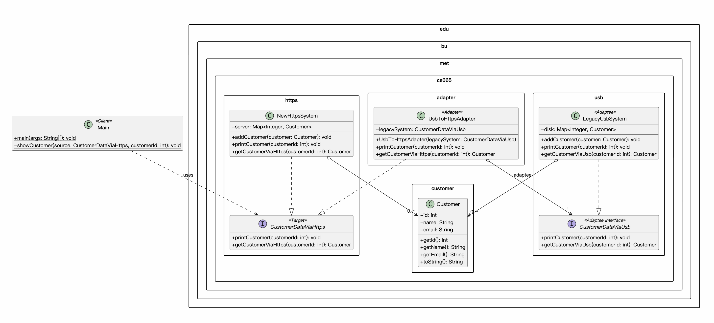

| CS-665       | Software Design & Patterns |
|--------------|----------------------------|
| Name         | Jiafu Guo                  |
| Date         | 11/10/2026                 |
| Course       | Fall 2026                  |
| Assignment # | 4                          |

# Assignment Overview

A company has two systems for accessing customer data. The legacy system reads customer data
from binary files on external disks connected through USB; its API is `CustomerDataViaUsb`.
The new system reads customer data from an external server through HTTPS and a REST API; its
API is `CustomerDataViaHttps`. The two interfaces do the same job but are not compatible:
the method that reads a customer has a different name in each.

This project integrates the two: an adapter lets the legacy system be used through the new
system's interface, so client code written for the new system can read the data that still
lives in the legacy system. Neither system is modified.

There is no graphical or command line user interface. The user interactions are implemented
as JUnit tests, as required by the assignment; `Main` runs a short console demo with Log4j.

# GitHub Repository Link:
https://github.com/guojiafu-jeff/cs-665-assignment-4

# Implementation Description

## Design overview

| Package | Classes | Responsibility |
|---|---|---|
| `edu.bu.met.cs665.customer` | `Customer` | The customer record (id, name, email) that both systems return. Immutable. |
| `edu.bu.met.cs665.usb` | `CustomerDataViaUsb` (interface), `LegacyUsbSystem` | The legacy system: the API given in the assignment and a mock implementation of it. |
| `edu.bu.met.cs665.https` | `CustomerDataViaHttps` (interface), `NewHttpsSystem` | The new system: the API given in the assignment and a mock implementation of it. |
| `edu.bu.met.cs665.adapter` | `UsbToHttpsAdapter` | Makes a legacy system usable through the new interface. |

The `usb` and `https` packages do not know each other; only the `adapter` package depends on
both. All three depend on `customer`.

Using the legacy system through the new interface takes one extra line:

```java
LegacyUsbSystem legacySystem = new LegacyUsbSystem();
legacySystem.addCustomer(new Customer(1, "A", "A@gmail.com"));

CustomerDataViaHttps source = new UsbToHttpsAdapter(legacySystem);  // plug in the adapter
Customer customer = source.getCustomerViaHttps(1);                  // served by the USB system
```

How the classes work together:

- Client code is written against `CustomerDataViaHttps` only (see `Main.showCustomer()` and the
  helper `nameOf()` in the tests).
- `NewHttpsSystem` implements that interface natively.
- `UsbToHttpsAdapter` also implements `CustomerDataViaHttps` and holds a reference to a
  `CustomerDataViaUsb`. `getCustomerViaHttps(id)` is forwarded to `getCustomerViaUsb(id)` and
  `printCustomer(id)` to the legacy `printCustomer(id)`. The adapter adds no behavior and stores
  no customer data.
- `LegacyUsbSystem` and `NewHttpsSystem` are mocks: each keeps its customer records in an
  in-memory map and logs what the real system would do ("USB: reading customer_1.bin from the
  external disk", "HTTPS: GET https://api.example.com/customers/101"). The log therefore shows
  which system really served a request.

Adapter pattern roles:

| Role | Class |
|---|---|
| Target (the interface the client expects) | `CustomerDataViaHttps` |
| Adaptee (the existing class with the incompatible API) | `LegacyUsbSystem`, used through its interface `CustomerDataViaUsb` |
| Adapter | `UsbToHttpsAdapter` |
| Client | `Main.showCustomer()` and the JUnit tests |
| Native implementation of the Target | `NewHttpsSystem` |

Errors: both systems throw `IllegalArgumentException` for an unknown customer id, and the
adapter lets that exception pass through unchanged. `Customer` and `UsbToHttpsAdapter` reject
invalid constructor arguments with `IllegalArgumentException`.

## Assumptions

1. Both systems return the same `Customer` record (id, name, email); it is the only type the
   two systems share. The assignment's interfaces mention `Customer` without defining it.
2. No real USB disk or REST server is available, so both systems are in-memory mocks that log
   what the real system would do.
3. Customer ids are positive integers and unique within one system. Each system holds its own
   customers; the legacy data has not been migrated to the new system.
4. An unknown id is an error in both systems (`IllegalArgumentException`). The adapter does
   not change this behavior.
5. The adapter is one-way, as the assignment asks: the new interface on top of the old API.
   An adapter for the opposite direction is a possible extension.
6. The adapter must not add behavior: no caching, no logging, no data of its own.
7. `printCustomer` writes the record to the log.

## Flexibility

- Another legacy implementation (a different disk format, another vendor's USB reader) works
  with the same adapter, because the adapter depends on the `CustomerDataViaUsb` interface and
  not on `LegacyUsbSystem`.
- A third system with yet another API (for example Bluetooth) is integrated by adding one new
  adapter class that implements `CustomerDataViaHttps`; no existing class changes.
- The legacy system can be retired later by deleting the `usb` and `adapter` packages. Client
  code does not change, because it never referenced them.
- The opposite direction (old clients using the new system) would be one more small class,
  `HttpsToUsbAdapter`, built the same way.

## Simplicity and understandability

- Each package is one idea of the problem statement: the shared record, the old system, the
  new system, and the adapter between them.
- The two given interfaces are used exactly as specified in the assignment.
- The adapter is about twenty lines of code: a constructor and two one-line forwarding methods.
- The mocks log the "physical" action they stand for, so running the demo shows at a glance
  that a call made through the new interface was served by the USB system.
- Every file and method has a documentation comment that names its role in the pattern.

## Avoiding duplicated code

- Without the adapter, every client would need two code paths: one calling
  `getCustomerViaHttps` and one calling `getCustomerViaUsb`. With the adapter there is a single
  client code path for both systems; the translation between the two APIs exists once, in
  `UsbToHttpsAdapter`.
- Inside each system, `printCustomer` reuses the system's own lookup method, so the lookup and
  the unknown-id rule exist once per system.
- The text form of a record exists once, in `Customer.toString()`.
- The two mock systems look alike on purpose but share no code: they stand for two independent
  products, and coupling them through a common base class would defeat the point of the
  exercise. The only thing they share is the `Customer` type.

Why it matters: a rule that lives in one place is changed in one place, behaves the same
everywhere and is tested once, which means fewer bugs.

## Design patterns

- **Adapter** (structural, covered in class), implemented as an object adapter. The problem
  is the one the pattern is defined for: two interfaces that do the same job are incompatible,
  the existing class (the legacy system) should not be modified, and client code should keep
  using the interface it expects. `UsbToHttpsAdapter` implements the Target interface
  `CustomerDataViaHttps` and forwards every request to the Adaptee, a `CustomerDataViaUsb`.
- Object adapter rather than class adapter: the adapter holds the legacy system (composition)
  instead of extending `LegacyUsbSystem` (inheritance). It therefore works with any
  implementation of the legacy interface, is not affected by changes inside the legacy class,
  and does not expose the legacy methods to clients.
- Related patterns that were not appropriate: a Decorator keeps the interface and adds
  behavior, a Proxy keeps the interface and controls access, a Facade puts a new, simpler
  interface in front of a whole subsystem. Here the interface must change and no behavior must
  be added, which is exactly the Adapter.

## Tests

`TestCustomerDataAdapter` (8 tests, run with `mvn clean test`):

- each system returns its customers through its own API;
- the required scenario: a customer stored in the legacy system is read through the new
  interface via the adapter, and the very same record object is returned;
- one piece of client code works with the new system and with the adapted legacy system;
- the adapter stores no data: a customer added to the legacy system later is visible at once;
- `printCustomer` and errors are forwarded: an unknown id is rejected by the legacy system
  itself and the exception reaches the client unchanged;
- an adapter cannot be created without a legacy system.

## Use of AI assistance

I discussed the Adapter pattern and what should be considered into testing with Claude, and used it to help with the PlantUML code for the UML diagram and the formatting of this README.

# UML Class Diagram



The same diagram as a PDF: [uml/UML.pdf](uml/UML.pdf). Adapter pattern: `CustomerDataViaHttps`
is the Target, `LegacyUsbSystem` (with its interface `CustomerDataViaUsb`) the Adaptee, `UsbToHttpsAdapter` the
Adapter and `Main` the Client.

# Project Template Notes

The sections below come from the CS-665 Java project template and describe the build setup.

## Features included

- Java 25 Maven configuration with `maven.compiler.release` set to `25`
- Log4j 2 logging configuration in `src/main/resources/log4j2.xml`
- JUnit testing support
- JaCoCo coverage reports
- SpotBugs static analysis
- Checkstyle configuration under `config/`

## Prerequisites

Before building, install:

- Java 25 JDK
- Apache Maven 3.9 or newer

Check your environment with:

```bash
java -version
mvn -version
```

If Maven reports an older Java version, update `JAVA_HOME` and `PATH` so Maven uses JDK 25. For example on macOS:

```bash
export JAVA_HOME="$(/usr/libexec/java_home -v 25)"
export PATH="$JAVA_HOME/bin:$PATH"
mvn -version
```

## Build and run

Compile the project:

```bash
mvn clean compile
```

Run the unit tests:

```bash
mvn clean test
```

Generate coverage and build reports:

```bash
mvn clean verify
```

Run the demo (the same client code reads from the new system and, through the adapter, from the legacy system):

```bash
mvn compile exec:java
```

Launch the SpotBugs GUI:

```bash
mvn spotbugs:gui
```

Generate the Checkstyle report:

```bash
mvn checkstyle:checkstyle
```

## Useful reports

After running verification, inspect the generated reports in the `target/` directory:

- JaCoCo: `target/site/jacoco/index.html`
- Checkstyle HTML: `target/site/checkstyle.html`

## Notes

SpotBugs reports no findings for this project. Checkstyle warnings concern the 4-space
indentation used throughout the project.